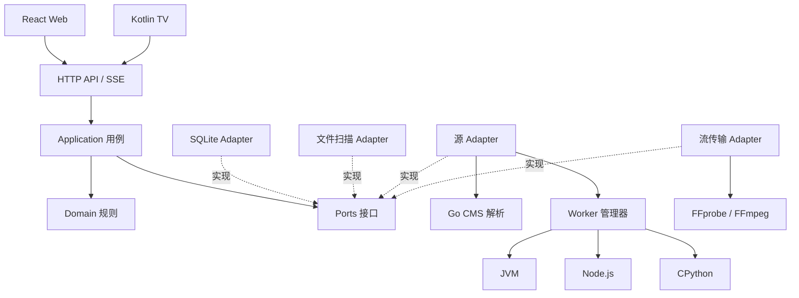
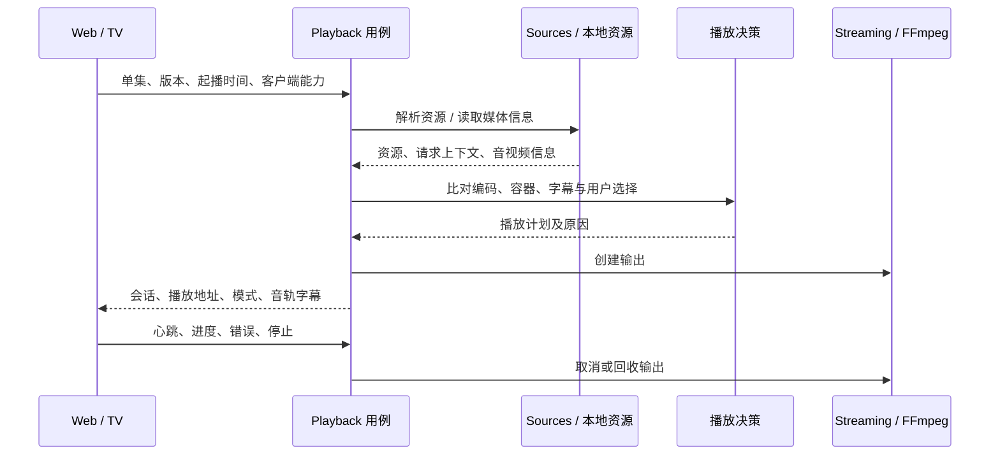

# TerryMediaHub 代码架构补充

更新日期：2026-11-04。状态：目标设计，未实施。

需求与完整目标目录见 [项目文档](project.md#三代码架构)。本文件补充实现边界与关键流程，不扩大首版范围。

## 1. 架构和依赖

采用模块化单体 Go 服务，SQLite 作为持久层。Web 静态产物由 Go 提供，电视通过相同公共 API 访问。JVM、Node.js、CPython 和 FFmpeg 都是独立受控进程。

### 服务端约束

- `domain` 只包含身份、规则、值对象和策略，不引用 HTTP、SQLite 或进程库。
- `application` 通过 `ports` 编排用例；存储和解析器接口由使用方定义，基础设施实现接口。
- `adapters/httpapi` 完成鉴权、输入输出转换和调用用例，不直接执行 SQL 或生成 FFmpeg 参数。
- `adapters/sqlite` 封装持久化；远程请求和子进程执行不放入长数据库事务。
- `bootstrap` 统一装配依赖和生命周期，不使用跨模块全局单例。
- `platform/process` 负责启动、取消、退出及进程树回收；应用层不自行散落启动进程逻辑。
- HTTP DTO、领域对象、数据库记录和 worker 消息分别定义，敏感运行时上下文不序列化给客户端。

### 客户端约束

Web 按功能组织路由、组件、请求及状态。远程数据与播放器临时状态分开管理；页面通过播放器控制器操作播放，不直接操作 hls.js 内部实例。

电视采用单向状态流：遥控操作进入 ViewModel，ViewModel 调用用例或仓储，StateFlow 驱动 Compose。播放器会话、焦点恢复和弹幕覆盖层各自封装，避免界面重组重建播放会话。

两端共享 OpenAPI 语义和视觉规范，不共享 UI 实现。电视报告实际解码能力，浏览器通过能力探测与播放错误反馈逐步修正能力判断。

## 2. 模型和数据归属

| 数据 | 归属模块 | 主要关系 |
|---|---|---|
| Media、Season、Episode | Library | 描述作品和集数身份 |
| MediaVersion、LocalAsset | Library | 描述版本及本地资源 |
| Subscription、Site、SourceEntry、PlaybackRoute | Sources | 保留订阅归属和全部线路 |
| Profile、Device | Household | 档案和设备授权 |
| Favorite、Follow、WatchProgress | Household / Playback | 按档案、作品或单集保存 |
| PlaybackSession | Playback | 关联资源、客户端能力和播放模式 |
| DanmakuBinding | Danmaku | 单集、弹幕资源与时间校准 |
| Job | Jobs | 后台任务、检查点、进度和错误 |

作品 ID 独立于源 URL，源条目的 ID 独立于临时播放直链。刷新地址、订阅迁移和线路失效不会重建个人观看记录。

合并操作维护旧 ID 到新身份的映射及资源关系，保留个人状态；拆分时允许管理员重新指定资源归属，避免复制出虚假的已看记录。自动归并无法确定的条目保留独立身份。

SQLite 启用 WAL，写入经过有界调度并保持短事务。数据库迁移与应用版本绑定。源删除和目录离线以不可用状态反映，不级联删除收藏、追剧或历史。

## 3. 关键流程

### 导入订阅和聚合搜索

1. 获取配置并记录配置来源，解析相对脚本、扩展及 JAR 地址。
2. 以订阅归属和站点标识登记站点，分别保留全局和专用运行时配置。
3. 识别站点协议，查询能力；配置入口、直播和网盘登录类站点按实际能力显示，不自动放入普通点播推荐。
4. 搜索先返回本地和已缓存结果，再受控并发查询在线站点。
5. SSE 逐批返回结果和各站状态；超时、取消或坏站不阻塞已可用结果。
6. 收藏或播放时补充详情；推荐仅缓存有限列表，不扩展成默认全量抓库。

### 播放会话

决策顺序为原码直连、原码代理、换封装、仅音频转码、视频转码。网络错误、403 和过期直链先重新解析或切换可匹配线路，不能直接用视频转码掩盖。

播放策略是可单独测试的规则；FFmpeg 模块根据明确播放计划构建参数。字幕优先客户端渲染，弹幕始终客户端绘制。可直通内容不主动降画质。

同一会话持有自己的请求上下文、临时凭据和资源生命周期。取消、客户端超时及服务退出时回收任务、FFmpeg 进程树和临时文件。拖动转码资源时按新位置重建输出，避免复用错误时间轴。

### 本地扫描

读取目录、视频、NFO、图片和字幕，建立文件索引；结合名称、目录及元数据区分电影和剧集。识别不确定时进入待整理状态。文件变更检测配合定期校验，目录暂时不可达不视为用户删除。所有扫描默认只读。

### 弹幕

按单集匹配源弹幕；可选弹弹play和 XML/JSON 导入。转换成统一时间轴，保留原数据来源、匹配和偏移。客户端跟随暂停、倍速及跳转更新时间，不启动视频重编码。

## 4. 公共 API 和 worker 协议

公共 API 使用 `/api/v1`，OpenAPI 是契约来源，生成 TypeScript 和 Kotlin 客户端模型；具体接口分组见主文档。搜索和任务进度使用 SSE，不通过 SSE 搬运视频。

创建播放会话提交资源选择、起播位置和客户端能力；响应包含会话 ID、播放地址、播放模式、音轨字幕及降级原因。客户端使用媒体 ID 和会话凭据，不能传入任意服务端路径获取文件。

统一源能力包含 `Capabilities`、`Home`、`Categories`、`List`、`Search`、`Detail`、`ResolvePlayback` 和 `Proxy`。CMS 在 Go 内实现，其他协议交给相应 worker。

worker 使用版本化逐行 JSON RPC，消息携带请求 ID、操作、站点上下文、参数和截止时间，响应包含结构化结果或错误。stdout 仅输出协议，stderr 输出日志；支持请求关联、超时、取消和崩溃恢复。

二进制源代理通过只监听回环地址并校验临时凭据的 HTTP 通道输出，不在 JSON RPC 中传输视频。每个 worker 按需要保留站点状态；不具备并发安全性的调用串行执行，通过独立实例隔离。

脚本、依赖和 JAR 按订阅隔离并按内容哈希缓存。运行时按需启动、空闲回收。播放解析优先于后台刷新，有限重试并保留最近可用版本。进程隔离仅解决故障边界，worker 仍需使用受限权限和独立工作目录，不继承管理凭据。

## 5. 部署、迁移和诊断

- Go 可执行程序与 Web 静态资源一同打包；JRE、Node、Python 和 FFmpeg 独立管理固定版本。
- 程序和数据分开存放，数据默认位于 `%ProgramData%\TerryMediaHub`；缓存、worker 工作目录与转码目录分开管理。
- Windows 服务和前台运行使用相同配置入口；首次初始化仅从本机完成，配对后局域网设备访问公共 API。
- 升级前备份 SQLite 和配置；迁移失败不得覆盖备份。数据库结构不兼容时回退使用旧版程序与匹配备份。
- 日志关联请求、任务、站点和播放会话，隐藏 Cookie、凭据与带签名地址中的敏感信息。
- 记录参考 Jellyfin 版本、FFmpeg 构建和第三方依赖许可证；JVM 宿主交付需要源码、依赖及可复现构建。

## 参考资料

- [Jellyfin 服务端源码](https://github.com/jellyfin/jellyfin)
- [jellyfin-ffmpeg 源码](https://github.com/jellyfin/jellyfin-ffmpeg)
- [Jellyfin 播放与转码策略](https://jellyfin.org/docs/general/post-install/transcoding/)
- [Android Media3 支持的格式](https://developer.android.com/media/media3/exoplayer/supported-formats)
